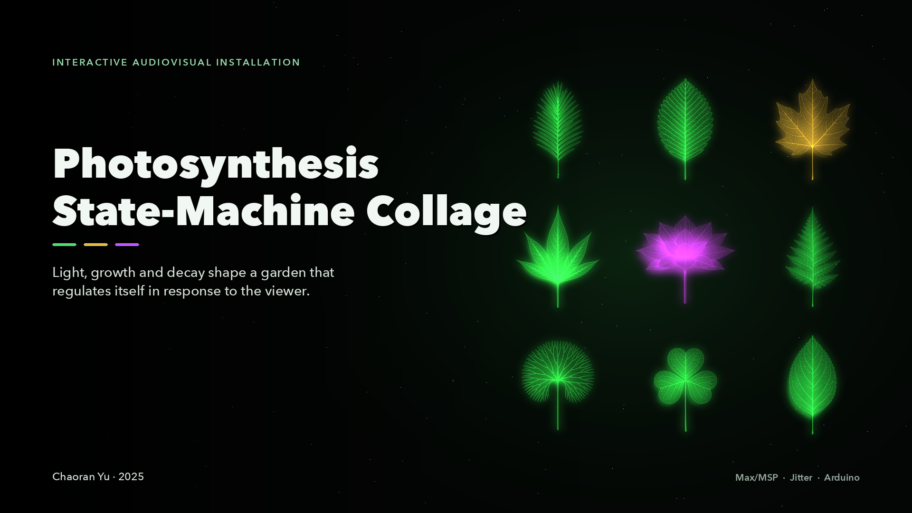
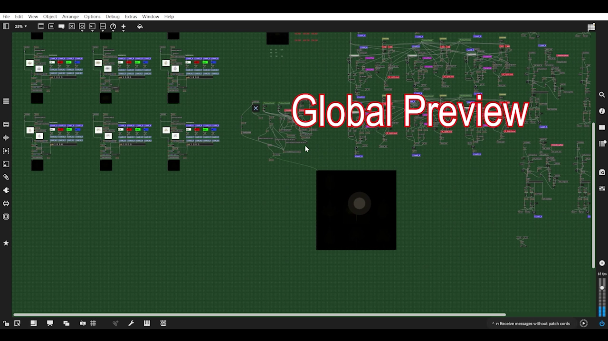
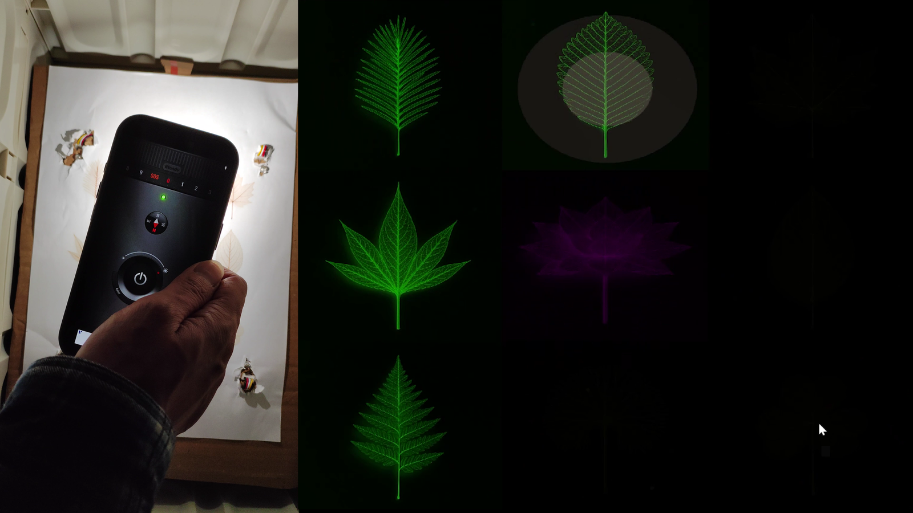

**English** · [简体中文](README.zh-CN.md)

[](docs/visuals/installation.png)

**An Interactive Audiovisual Installation for Generative Ambient Music**

Nine leaf collages grow and decay under a light sensor's gaze. Their maturity drives a state
machine that steers harmony, drones and environmental sound, so the garden re-collages itself
as the viewer moves a light across it.

[**Watch the demo ↗**](https://drive.google.com/file/d/1dAZhQM99LL0bezge-M0ikdAhsMcMClBs/view?usp=sharing) · [**Watch the walkthrough ↗**](https://drive.google.com/file/d/162i3yl4E_GZTOkkdpbw-Poe2VsJyE2QD/view?usp=sharing) · [**Source audio ↗**](https://drive.google.com/file/d/12wcDiPvGPxWM0x9073IEidhG6tUTDUko/view?usp=sharing) · [**Read the report**](REPORT.pdf) · [**Run it**](#run-it)

Chaoran Yu · 2025

<details>
<summary>Demonstration, walkthrough and audio</summary>

Long media is hosted on Google Drive rather than stored in the repository.

| Material | File | Link |
|---|---|---|
| Installation demonstration (about 10 minutes) | `Photosynthesis_StateMachine_Collage.mp4` | [Watch on Google Drive](https://drive.google.com/file/d/1dAZhQM99LL0bezge-M0ikdAhsMcMClBs/view?usp=sharing) |
| Technical walkthrough of the Max/MSP system (about 10 minutes) | `Photosynthesis_StateMachine_Collage_ProgramOverview.mp4` | [Watch on Google Drive](https://drive.google.com/file/d/162i3yl4E_GZTOkkdpbw-Poe2VsJyE2QD/view?usp=sharing) |
| Environmental recording — forest birds and wind in trees (`Birds` buffer) | `Ambience_Forest_Birds_WindInTrees.wav` | [Listen on Google Drive](https://drive.google.com/file/d/12wcDiPvGPxWM0x9073IEidhG6tUTDUko/view?usp=sharing) |
| Environmental recording — wind, vegetation and forest leaves (`Wind` buffer) | `Wind_Vegetation_Forest_Leaves.wav` | [Listen on Google Drive](https://drive.google.com/file/d/1rGqgRS4RvGVU52Eh0RFTe30jPhJqmpJ5/view?usp=sharing) |

All links are set to *anyone with the link can view*.

</details>

> **This release runs without hardware.** The patch is set up with the mouse and random
> brightness to simulate the lighting when no Arduino sensors are connected (the author's note
> is included at [docs/visuals/release-note.png](docs/visuals/release-note.png)). The
> four-sensor prototype is what the demo video shows.

## What I built

- A nine-unit state machine in which each unit's light intensity produces a growth value; the
  count of mature units iterates the whole system through its states.
- An Arduino input stage for four light sensors in the physical prototype; this release
  simulates the light with the mouse and random brightness instead.
- A Max/MSP sound system — synthesised note timbres, piano sources through `vst~`, a
  `cycle~` drone, and two environmental layers — with reverb on each voice.
- A 3×3 collage of AI-generated leaf images, inverted and stylised into luminous veins with
  `jit.op`, assembled with `jit.glue`, plus a sparkling particle layer.

## How it works

The piece treats light as food. Each of the nine plant units computes a real-time
light-intensity value from the sensor (or mouse) position and its own distance from the light
spot; growth and decay coefficients turn that value into a continuously updated growth state.
Everything else — colour, visual presence, the rhythm of a voice, the count of mature units —
follows from there.

### Light, distance and growth

The patch measures the distance between each leaf unit's centre and the light position with
the Pythagorean theorem, clips it, and maps it through the growth and decay rates
(`GrowthRate`, `DecayRate`, `StateDecayRate`). A unit that receives light brightens, turns from
yellow to green and grows; a unit that loses light decays immediately or, once mature, after a
delay. Thresholds inside the growth value ignite the leaf's associated voice, and the mature
count is incremented into the global state machine.

### The state machine

The system advances when enough units have matured. Each state has its own algorithmic logic —
deterministic rules plus controlled randomisation — and its own tempo mapping. Before maturity,
each state's BPM follows its internal state value, giving the units independent temporal
identities; once a unit matures, its BPM converges toward the global maximum. Local behaviours
therefore start asynchronously and gradually synchronise as the ecosystem matures.

The state also decides which environmental layers are audible: two ambient recordings, a soft
leaf-rustling texture and intermittent bird calls, fade in only after specific maturity
thresholds. The colour system follows the same logic: leaves run yellow to green, the central
lotus drifts toward red and purple as the global level rises, and the sparkle layer changes its
mix of white, green and random colours.

### The sound system

Three families of sound:

- **Note timbres** — waveform-synthesis voices designed in Max, plus several piano sources
  loaded through `vst~`. Each voice runs through its own Valhalla VintageVerb instance, with
  different settings for depth and motion.
- **The drone** — the lotus at the centre of the field triggers a sustained chord built from
  multiple `cycle~` oscillators, with an LFO continuously modulating the timbre. The viewer's
  illuminated position on screen shifts the drone's stability, tying the harmony to the light.
- **Environmental layers** — the two recordings above, triggered by maturity thresholds.

The harmonic framework is built on **Cmaj7** and **Fmaj7**; the transition between them is
decided by the number of mature units. At the highest maturity threshold the whole system
changes key, so the harmonic field iterates and evolves with the form.

### The visual engine

Nine plant images were generated with an AI-assisted workflow (OpenAI's image model, credited in
the report) in a consistent style, then processed in Jitter: inversion and multiplication with
`jit.op` turn the leaves into luminous vein patterns, and `jit.glue @rows 3 @columns 3` assembles
them into the 3×3 collage that is the visual field. Each cell's brightness, hue and presence are
driven by that unit's growth state. A separate sparkle system flickers highlights across the
screen and changes with the state.

### Interaction

The intended interface is physical: four Arduino light sensors on a board. Pointing a phone
flashlight at the board moves the light spot, and the patch follows position and brightness.
For debugging and for running without hardware, mouse movement can substitute for the light
spot. The installation is designed to be shown in a dim room, so the light is the only bright
thing the camera and the audience see.

## System architecture

<details>
<summary>View the system overview and the installation</summary>



The whole work lives in one Max/MSP patcher: an Arduino input stage, per-leaf distance and
growth calculations, a nine-unit state machine, nine MIDI/voice generators, a shared audio bus
with VST processing, the Jitter collage and the sparkle system.



The prototype: a board of four light sensors and a phone torch on the left, the 3×3 collage
responding on the right. The full set of architecture figures is in
[`docs/architecture/`](docs/architecture/).

</details>

## Run it

1. Install **Max 9** (the patch was saved with 9.0.8) with **Jitter**.
2. Install the plug-ins the patch expects: **Valhalla VintageVerb** and **Scarred Piano**
   (`vst~`, `mc.vst~`). Both are commercial and are not distributed here; without them the
   patch opens but the VST voices stay silent unless you substitute your own instruments.
3. Keep the project folder as shipped: `Photosynthesis_StateMachine_Collage.maxpat` beside
   `Photosynthesis_StateMachine_Collage_Files/`. Add
   `Photosynthesis_StateMachine_Collage_Files/Levan_Patch` to Max's search path
   (*Options → File Preferences*), or open the patch from inside that structure and let Max
   resolve its project folder.
4. Download the two environmental WAVs from the media table above into `S2_Leaf/` (or supply
   replacements), or leave them out and run without those layers — see the
   [media guide](patch/Photosynthesis_StateMachine_Collage_Files/S2_Leaf/README.md).
5. Hardware is optional in this release: the patch simulates the light with the mouse and random
   brightness. To run the four-sensor prototype, connect the Arduino, load the sketch (not
   included) and reassign the port letters in `p Arduino` (`serial c` / `serial f`, 9600 baud).
6. Open `patch/Photosynthesis_StateMachine_Collage.maxpat`, confirm the collage loads, set up
   Max's audio (a stereo output and the VST plug-ins), then click the **GStart** toggle — the
   main start control described as the Start button in the user guide.

The operating manual, including the interaction model, the state transitions, shutdown and
troubleshooting, is in [`docs/setup-guide.md`](docs/setup-guide.md). The author's original
[`USER_GUIDE.docx`](USER_GUIDE.docx) is included as well.

## Requirements

- **Max 9.0.8 or later**, with Jitter (the visuals use `jit.window`, `jit.glue`, `jit.op`,
  `jit.matrix`)
- **Valhalla VintageVerb** and **Scarred Piano** VST plug-ins for the intended timbres
- **Arduino** with four light sensors for the physical prototype (optional — the released
  patch simulates light with the mouse and random brightness)
- The nine leaf images that ship with the repository; the two environmental WAVs are linked
  from the README (download or substitute)
- A stereo audio output and a dim room

The patch was saved as Max 9.0.8 (x64). The operating system and hardware were not recorded in
the project files — see [environment notes](docs/environment.md).

## The written report

[](REPORT.pdf)

[**Photosynthesis State-Machine Collage — project report (PDF, 7 pages)**](REPORT.pdf)

The report covers the concept and aesthetic lineage (including Brian Eno's generative work),
the four-part system architecture, the state machine, the sound system's timbres and harmony,
the visual engine, the Arduino interaction, a critical reflection and the third-party credits.

## Repository layout

<details>
<summary>View the repository tree</summary>

```
README.md                     This page
README.zh-CN.md               Simplified Chinese version
REPORT.pdf                    Written project report (7 pages)
USER_GUIDE.docx               Prototype user guide (operating instructions)
NOTICE.md                     Copyright and terms of use
llms.txt                      Machine-readable index for AI tools
docs/
    setup-guide.md            Operating manual: wiring, search paths, interaction, states
    ai-assistant-guide.md     Setup guide written for AI assistants
    environment.md            Recorded environment and reproduction limits
    verification.md           Static checks and optional fresh-setup checks
    release-notes.md          Initial public release notes
    visuals/                  Cover and installation photograph
    architecture/             Annotated patch figures from the walkthrough video
patch/
    Photosynthesis_StateMachine_Collage.maxpat   Main Max patch
    Photosynthesis_StateMachine_Collage_Files/
        Levan_Patch/          13 Max abstractions (11 loaded directly by the main patch)
        S2_Leaf/              Nine leaf images, the media guide and (empty) sample slots
```

The main patch expects `Photosynthesis_StateMachine_Collage_Files/` beside it, and resolves
its abstractions from `Levan_Patch/`.

</details>

## What is not included

- **The two environmental WAV files are linked, not stored.** They are Soundly recordings
  (`SND0432`, `SND0247`); the media table links them from Google Drive, and downloading them
  into `S2_Leaf/` restores the original ambience. The raw files are kept out of the repository
  to respect the sample library's terms and to keep the clone small; the
  [media guide](patch/Photosynthesis_StateMachine_Collage_Files/S2_Leaf/README.md) explains how
  to substitute your own recordings instead.
- **The VST plug-ins.** Valhalla VintageVerb and Scarred Piano are commercial products, and
  the Valhalla preset snapshots referenced by the patch are not distributed. Substitute your
  own instruments or buy the plug-ins.
- **The Arduino sketch.** The report describes AI-assisted Arduino code that measures four
  light sensors and sends them over serial, but no `.ino` file was part of the project files
  supplied for this repository. The released patch therefore relies on its built-in mouse and
  random-brightness simulation; for the physical rig the patch reads `serial c` and `serial f`
  at 9600 baud.
- **Videos and recordings** — linked from Google Drive above.

## Set up with an AI assistant

To have an AI assistant walk you (or itself) through the installation, paste this line into it:

```
Read https://raw.githubusercontent.com/Chora666/photosynthesis-state-machine-collage/main/docs/ai-assistant-guide.md and help me get Photosynthesis State-Machine Collage running.
```

That file is a setup guide written for AI assistants: what to install, how to resolve the
project folder, what to substitute for the missing media, how to verify, and where the setup
usually breaks. [`llms.txt`](llms.txt) carries the same pointers in the llms.txt format.

## Credits

Third-party tools and media are credited in the report: Max/MSP 9 (Cycling '74), Arduino IDE
(Arduino.cc), Valhalla VintageVerb (Valhalla DSP), Scarred Piano (Infinit Essentials / Loot
Audio), AI-generated leaf images (OpenAI image model), and Soundly for the two environmental
recordings (`SND0432`, `SND0247`). The report also acknowledges Brian Eno's generative work as
an artistic influence.

## Licensing

- **The Max/MSP patch and abstractions** — [PolyForm Noncommercial 1.0.0](LICENSE.md). Free for
  any noncommercial purpose: study, teaching, research, personal and noncommercial artistic
  work. **Commercial use requires a separate licence** — contact the author (see below).
- **Documentation, report and leaf images** — [CC BY-NC 4.0](https://creativecommons.org/licenses/by-nc/4.0/).
  Share and adapt with attribution, non-commercial use only.

Work made with the system is your own, not a derivative of the patch, so these licences say
nothing about your own recordings or exhibitions.

For a commercial licence, open an issue at
[the issue tracker](https://github.com/Chora666/photosynthesis-state-machine-collage/issues) or
message [@Chora666](https://github.com/Chora666). Citation format and the credit line are in
[NOTICE.md](NOTICE.md). Third-party material keeps its own licences and is not relicensed here.
