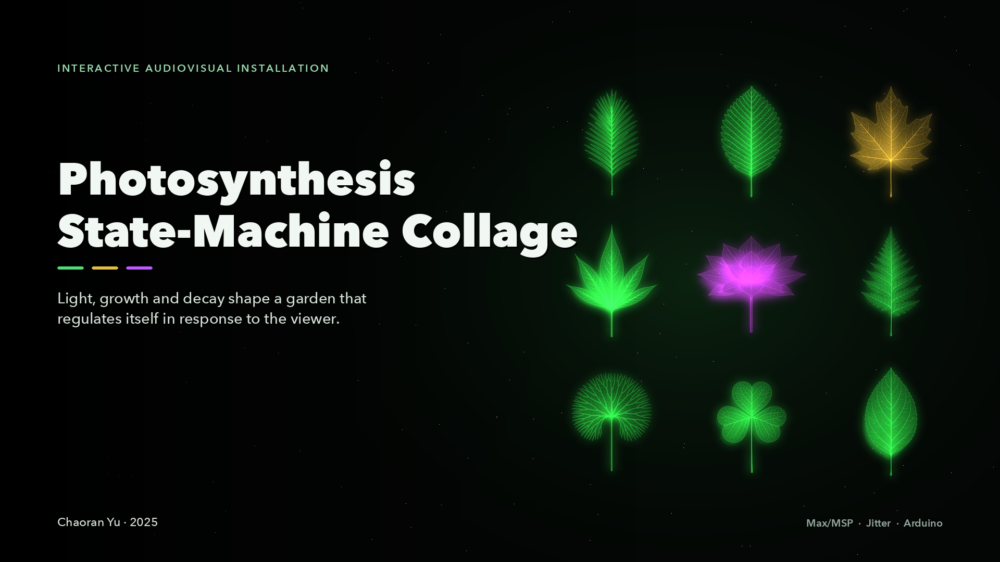
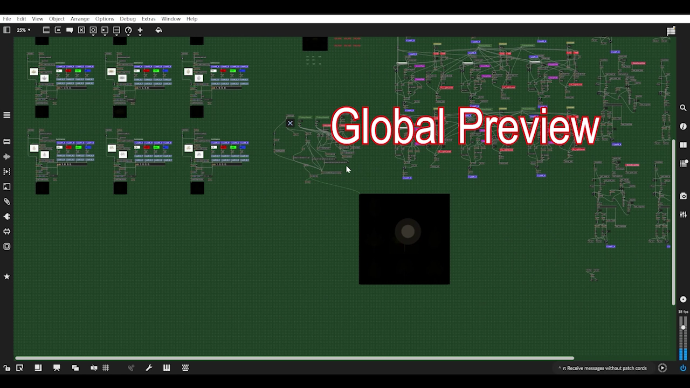
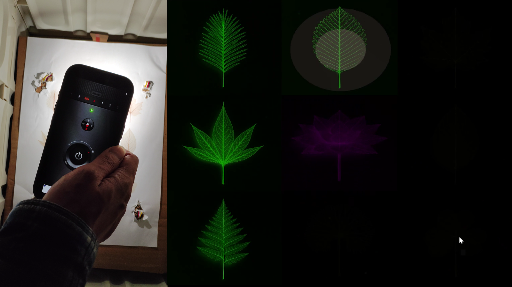

[English](README.md) · **简体中文**

[](docs/visuals/installation.png)

**一件生成实时氛围音乐的互动视听装置**

九片叶脉拼贴在光线的注视下生长与衰败；它们的成熟度推动一个状态机，进而决定和声、持续音与
环境声的走向——观众移动光源时，「花园」会重新拼贴自己。

[**观看演示 ↗**](https://drive.google.com/file/d/1dAZhQM99LL0bezge-M0ikdAhsMcMClBs/view?usp=sharing) · [**观看讲解 ↗**](https://drive.google.com/file/d/162i3yl4E_GZTOkkdpbw-Poe2VsJyE2QD/view?usp=sharing) · [**素材音频 ↗**](https://drive.google.com/file/d/12wcDiPvGPxWM0x9073IEidhG6tUTDUko/view?usp=sharing) · [**阅读报告**](REPORT.pdf) · [**运行指南**](#运行)

俞超然（Chaoran Yu）· 2025

<details>
<summary>演示、讲解与录音</summary>

较长的媒体文件托管在 Google Drive，不存放在仓库中。

| 内容 | 文件 | 链接 |
|---|---|---|
| 装置演示（约 10 分钟） | `Photosynthesis_StateMachine_Collage.mp4` | [在 Google Drive 观看](https://drive.google.com/file/d/1dAZhQM99LL0bezge-M0ikdAhsMcMClBs/view?usp=sharing) |
| Max/MSP 系统技术讲解（约 10 分钟） | `Photosynthesis_StateMachine_Collage_ProgramOverview.mp4` | [在 Google Drive 观看](https://drive.google.com/file/d/162i3yl4E_GZTOkkdpbw-Poe2VsJyE2QD/view?usp=sharing) |
| 环境录音——林中鸟鸣与穿林风声（`Birds` 缓冲） | `Ambience_Forest_Birds_WindInTrees.wav` | [在 Google Drive 收听](https://drive.google.com/file/d/12wcDiPvGPxWM0x9073IEidhG6tUTDUko/view?usp=sharing) |
| 环境录音——风、植被与落叶（`Wind` 缓冲） | `Wind_Vegetation_Forest_Leaves.wav` | [在 Google Drive 收听](https://drive.google.com/file/d/1rGqgRS4RvGVU52Eh0RFTe30jPhJqmpJ5/view?usp=sharing) |

以上链接均设置为「知道链接的人均可查看」。

</details>

> **这一版无需硬件即可运行。** 发行版 patch 已设置为用鼠标与随机亮度模拟光照，因此在没有连接
> Arduino 传感器时也能观看（作者原话见 [docs/visuals/release-note.png](docs/visuals/release-note.png)）。
> 演示视频中运行的是带四个光敏传感器的完整原型。

## 我实现的内容

- 一个九单元状态机：每个单元的光照强度生成生长值，成熟单元的数量推动整个系统进入下一状态。
- 实体原型中由 Arduino 与四个光敏传感器构成输入层；这一发行版改用鼠标与随机亮度模拟光照。
- Max/MSP 声音系统——自己合成的音符音色、经 `vst~` 加载的钢琴音源、`cycle~` 构成的持续音，
  以及两层环境声；每个声部各有混响。
- 九张 AI 生成植物图像经 `jit.op` 反相与塑形为发光叶脉，由 `jit.glue` 拼成 3×3 拼贴，
  另有一层闪粒子系统。

## 工作原理

作品把光当作养分。九个植物单元各自根据传感器（或鼠标）位置与自身到光斑的距离，实时计算一个
光照强度值；生长与衰减系数把它转换成持续更新的生长状态。此后的一切——颜色、画面是否存在、
某个声部的节奏、成熟单元的数量——都由这个值推导出来。

### 光、距离与生长

patch 用勾股定理计算每个叶片中心到光斑的距离，裁切后经生长速率与衰减速率
（`GrowthRate`、`DecayRate`、`StateDecayRate`）映射成生长值。受到光照的单元会变亮、由黄转绿
并生长；失去光照的单元立即衰减，已成熟的单元则延迟一段时间再衰减。生长值越过阈值时点亮
对应声部，成熟计数则送入全局状态机。

### 状态机

当成熟单元累积到一定数量，系统进入下一个状态。每个状态都有自己的算法逻辑——确定性规则加上
受控随机化——以及自己的速度映射。成熟之前，每个状态的 BPM 只跟随自身状态值，让各单元拥有
独立的时间身份；一旦成熟，BPM 便向全局最大值收敛。局部的行为因此先异步展开，再随着生态成熟
逐渐同步。

状态同时决定哪些环境声层可以被听见：两段环境录音——轻柔的落叶摩擦声与间断的鸟鸣——只在
特定成熟阈值之后淡入。颜色系统遵循同样的逻辑：叶片由黄到绿，中央莲花随全局音量增加趋向
红紫，闪粒子的配色也在白色、绿色与随机色之间切换。

### 声音系统

三类声音：

- **音符音色**——在 Max 中设计的波形合成音色，加上通过 `vst~` 加载的若干钢琴音源。每个声部
  都经过独立的 Valhalla VintageVerb 实例，参数各不相同，以制造纵深与运动感。
- **持续音**——画面中央的莲花触发一个由多个 `cycle~` 振荡器叠成的持续和弦，LFO 不断调制音色。
  观众在屏幕上点亮的位置会改变持续音的稳定程度，让和声与光直接耦合。
- **环境声**——上述两段录音，由成熟阈值触发。

和声框架以 **Cmaj7** 与 **Fmaj7** 为核心，两者之间的转换由成熟单元的数量决定。
达到最高成熟阈值时，整首作品会转调，和声场因此随曲式迭代演化。

### 视觉引擎

九张植物图像通过 AI 辅助流程生成（OpenAI 图像模型，报告第三方素材中有记录），风格统一；
随后在 Jitter 中处理：反相与 `jit.op` 乘法把叶片变成发光叶脉，`jit.glue @rows 3 @columns 3`
拼接成作为视觉主体的 3×3 拼贴。每个格子的亮度、色相与存在感由该单元的生长状态驱动。
另一套闪粒子系统在画面上产生闪烁高光，并随状态变化。

### 互动

目标界面是实体化的：一块装有四个 Arduino 光敏传感器的板子。用手电筒照向板子即可移动光斑，
patch 会跟随位置与亮度。调试或无硬件时，鼠标移动可以替代光斑。作品适合在昏暗房间里展出，
这样光就是观众与镜头唯一能看到的高亮。

## 系统架构

<details>
<summary>展开系统总览与装置现场</summary>



整件作品在一个 Max/MSP patcher 中完成：Arduino 输入层、每个叶片的距离与生长计算、九单元
状态机、九个 MIDI／声部生成器、带 VST 处理的共享音频总线、Jitter 拼贴与闪粒子系统。



原型：左侧是装有四个光敏传感器的板子与手机手电筒，右侧是随之响应的 3×3 拼贴。完整图示见
[`docs/architecture/`](docs/architecture/)。

</details>

## 运行

1. 安装 **Max 9**（patch 保存于 9.0.8）并包含 **Jitter**。
2. 安装 patch 需要的插件：**Valhalla VintageVerb** 与 **Scarred Piano**（`vst~`、`mc.vst~`）。
   两者都是商业插件，不随仓库分发；缺少它们时 patch 仍能打开，但 VST 声部没有声音，除非换成
   自己的音源。
3. 保持工程目录原样：`Photosynthesis_StateMachine_Collage.maxpat` 与
   `Photosynthesis_StateMachine_Collage_Files/` 必须并排。把
   `Photosynthesis_StateMachine_Collage_Files/Levan_Patch` 加入 Max 的搜索路径
   （*Options → File Preferences*），或在该结构中打开 patch，让 Max 按工程文件夹解析。
4. 从上方媒体表把两段环境声 WAV 下载到 `S2_Leaf/`（或换成你自己的录音），也可以省略这两层——
   见[媒体说明](patch/Photosynthesis_StateMachine_Collage_Files/S2_Leaf/README.md)。
5. 这一版里硬件是可选的：patch 用鼠标与随机亮度模拟光照。若要运行带四个传感器的原型，
   请连接 Arduino、加载相应代码（未随仓库提供），并在 `p Arduino` 中把串口改成实际端口
   （`serial c` / `serial f`，9600 波特率）。
6. 打开 `patch/Photosynthesis_StateMachine_Collage.maxpat`，确认拼贴加载完成，设置 Max 音频
   （立体声输出与 VST 插件），然后点击 **GStart** 开关——即用户手册中所说的 Start 按钮。

操作手册（互动方式、状态转换、关闭方法、排错）见 [`docs/setup-guide.md`](docs/setup-guide.md)。
作者原始的 [`USER_GUIDE.docx`](USER_GUIDE.docx) 也一并收录。

## 环境要求

- **Max 9.0.8 或更高版本**，含 Jitter（视觉使用 `jit.window`、`jit.glue`、`jit.op`、`jit.matrix`）
- **Valhalla VintageVerb** 与 **Scarred Piano** VST 插件（用于目标音色）
- **Arduino** 与四个光敏传感器（用于实体原型；可选——发行版 patch 用鼠标与随机亮度模拟光照）
- 随仓库提供的九张叶片图像；两段环境声 WAV 链接自 README（可下载或替换）
- 立体声输出与一个昏暗的房间

patch 保存为 Max 9.0.8（x64）。工程文件没有记录操作系统与硬件——详见[环境说明](docs/environment.md)。

## 项目报告

[](REPORT.pdf)

[**Photosynthesis State-Machine Collage —— 项目报告（PDF，7 页）**](REPORT.pdf)

报告涵盖概念与美学脉络（包括 Brian Eno 的生成音乐实践）、四部分系统架构、状态机、声音系统的
音色与和声、视觉引擎、Arduino 互动、批评性反思以及第三方素材说明。

## 仓库结构

<details>
<summary>展开目录树</summary>

```
README.md                     本页
README.zh-CN.md               简体中文版
REPORT.pdf                    项目报告全文（7 页）
USER_GUIDE.docx               原型用户手册（操作说明）
NOTICE.md                     版权与使用条款
llms.txt                      给 AI 工具用的机器可读索引
docs/
    setup-guide.md            操作手册：接线、搜索路径、互动、状态
    ai-assistant-guide.md     写给 AI 助手的安装说明
    environment.md            记录的环境与复现限制
    verification.md           静态检查与可选的新环境检查
    release-notes.md          首次公开发布说明
    visuals/                  封面与装置现场照片
    architecture/             讲解视频中的 patch 图示（带标注）
patch/
    Photosynthesis_StateMachine_Collage.maxpat   Max 主 patch
    Photosynthesis_StateMachine_Collage_Files/
        Levan_Patch/          13 个 Max 抽象（主 patch 直接加载其中 11 个）
        S2_Leaf/              九张叶片图像、媒体说明与（空的）样本位置
```

主 patch 需要与 `Photosynthesis_StateMachine_Collage_Files/` 并排，并从 `Levan_Patch/`
解析抽象。

</details>

## 未包含的内容

- **两段环境声 WAV 以链接形式提供，不存放在仓库中。** 它们是 Soundly 的录音（`SND0432`、
  `SND0247`）；上方媒体表从 Google Drive 链接到它们，下载到 `S2_Leaf/` 即可还原原本的环境声。
  原始文件不放进仓库，一是尊重素材库的授权条款，二是避免仓库体积过大；
  [媒体说明](patch/Photosynthesis_StateMachine_Collage_Files/S2_Leaf/README.md) 里也写了如何换成
  你自己的录音。
- **VST 插件。** Valhalla VintageVerb 与 Scarred Piano 是商业产品，patch 引用的 Valhalla
  预设快照也没有随仓库提供。请替换为自己的音源，或购买插件。
- **Arduino 代码。** 报告说明用 AI 辅助编写了读取四个光敏传感器并通过串口发送的代码，但提供给
  本仓库的工程文件中没有 `.ino` 文件。因此发行版 patch 依赖内置的鼠标与随机亮度模拟；
  运行实体设备时，patch 以 9600 波特率读取 `serial c` 与 `serial f`。
- **视频与录音** —— 见上方的 Google Drive 链接。

## 交给 AI 助手来装

如果希望让 AI 助手带着你（或由它自己）完成安装，把下面这行贴给它：

```
Read https://raw.githubusercontent.com/Chora666/photosynthesis-state-machine-collage/main/docs/ai-assistant-guide.md and help me get Photosynthesis State-Machine Collage running.
```

这份文件是专门写给 AI 助手的安装说明：要装什么、如何解析工程目录、缺失的媒体用什么替代、
如何验证，以及通常会在哪里卡住。[`llms.txt`](llms.txt) 用 llms.txt 格式给出同样的入口。

## 致谢

第三方工具与素材在报告中列出：Max/MSP 9（Cycling '74）、Arduino IDE（Arduino.cc）、
Valhalla VintageVerb（Valhalla DSP）、Scarred Piano（Infinit Essentials / Loot Audio）、
AI 生成叶片图像（OpenAI 图像模型），以及 Soundly 提供的两段环境录音（`SND0432`、`SND0247`）。
报告也致谢 Brian Eno 的生成作品所带来的艺术影响。

## 许可

- **Max/MSP patch 与抽象** —— [PolyForm Noncommercial 1.0.0](LICENSE.md)。非商业用途免费：
  学习、教学、研究、个人项目、非商业演出与展览。**商业使用需单独取得授权**（见下）。
- **文档、报告与叶片图像** —— [CC BY-NC 4.0](https://creativecommons.org/licenses/by-nc/4.0/)。
  需署名，仅限非商业使用。

用这套系统做出的作品属于你自己的，不构成 patch 的衍生作品，因此上述许可不涉及你自己的录音或展览。

商业授权请联系：在 [issue 区](https://github.com/Chora666/photosynthesis-state-machine-collage/issues)
开一个 issue，或在 GitHub 上联系 [@Chora666](https://github.com/Chora666)。
引用格式与致谢写法见 [NOTICE.md](NOTICE.md)。第三方素材保留各自的授权，不在此重新授权。
